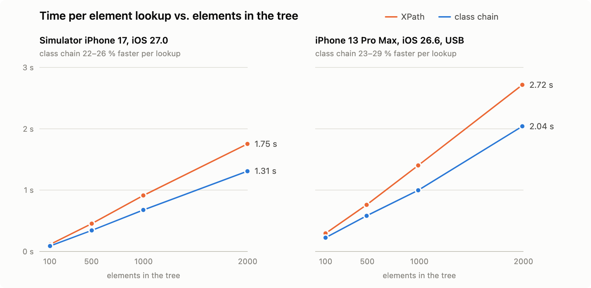

<!--
Images: dev.to does not take relative paths. Upload the PNGs from docs/articles/img/
in the editor (or use their raw GitHub URLs) and replace the paths below.
All numbers come from audit/coverage-report.md and audit/device/results-scale-*.json.
-->

## TL;DR

- **Class chain is ~25 % faster than XPath** for a typical iOS lookup: 70 ms saved at 100 elements, 676 ms at 2000 (iPhone).
- **It only matters on big screens.** On small ones the gain is milliseconds, and on a real project the whole test run was not faster.
- **~87 % of real XPath locators can be converted.** The converter does it with **no wrong chains** and skips or flags the rest.

```bash
npx github:domovou69/xpath-to-class-chain ./tests          # preview the diff
npx github:domovou69/xpath-to-class-chain ./tests --write  # apply it
```

---

**Contents**

1. [What a class chain is](#what-a-class-chain-is)
2. [Why converting by hand goes wrong](#why-converting-by-hand-goes-wrong)
3. [What the tool does](#what-the-tool-does)
4. [How I checked that it is right](#how-i-checked-that-it-is-right)
5. [How much faster is it?](#how-much-faster-is-it)
6. [Where the chain is slower](#where-the-chain-is-slower)
7. [What I took away](#what-i-took-away)
8. [Try it](#try-it)

---

If you run Appium tests on iOS, you have probably heard that XPath is slow and that `-ios class chain` is faster. I wanted two things I could not find anywhere:

1. A tool that converts existing XPath locators to class chain **without silently changing which element they find**.
2. A real number: how much faster is it, and does that depend on the size of the screen?

This post covers both. The tool is open source: [xpath-to-class-chain](https://github.com/domovou69/xpath-to-class-chain). In short: the chain was faster in **all 240** timed lookups (22–29 %, simulator and iPhone), **489 of 562** real locators have a class chain, and a few shapes (`visible`, lookups of dozens of elements) get **slower**, see below.

## What a class chain is

A class chain is WebDriverAgent's (WDA's) own locator language for iOS. Like XPath, it is a path of element types. Unlike XPath, each filter is an [NSPredicate](https://developer.apple.com/documentation/foundation/nspredicate) in backticks:

| XPath                                                        | Class chain                                    |
| ------------------------------------------------------------ | ---------------------------------------------- |
| `//XCUIElementTypeButton` (any depth)                        | `**/XCUIElementTypeButton`                     |
| `//XCUIElementTypeCell/XCUIElementTypeButton` (direct child) | `**/XCUIElementTypeCell/XCUIElementTypeButton` |
| `[@name="Pay"]`                                              | ``[`name == "Pay"`]``                          |
| `[contains(@label,"Total")]`                                 | ``[`label CONTAINS "Total"`]``                 |
| `[@name="a" and @label="b"]`                                 | ``[`name == "a" AND label == "b"`]``           |
| `//*` (any type)                                             | `**/*`                                         |

In a test, it is just another locator strategy:

```js
// WebdriverIO
await $('-ios class chain:**/XCUIElementTypeButton[`name == "Pay"`]').click();
```

```java
// Java client
driver.findElement(AppiumBy.iOSClassChain("**/XCUIElementTypeButton[`name == \"Pay\"`]")).click();
```

**Why it is faster.** For XPath, WDA takes a snapshot of the whole accessibility tree, writes it out as XML, runs the XPath over it with libxml2 and maps the matches back to elements. A class chain skips the XML step: WDA turns it straight into XCTest queries. Both still walk the whole tree, so the gain is a percentage, not a fixed number of milliseconds.

## Why converting by hand goes wrong

The two languages look alike but behave differently:

- **Positions.** XPath `//Button[2]` is the 2nd Button under _each_ parent; class chain `**/Button[2]` is the 2nd of _all_ matches.
- **Order.** XPath `(//Button)[2]` counts matches top to bottom; WDA counts them level by level (breadth-first). No class chain counts like XPath here.
- **Text.** `==` compares exactly, but `CONTAINS`, `MATCHES` and `[c]` compare normalized text (a fullwidth `Ｑ` equals `Q`).
- **Errors.** The Appium driver turns an invalid chain into "no such element", so a typo looks like a flaky test, not a syntax error.

That last point is the reason for the whole project: a wrong chain does not fail loudly.

## What the tool does

It scans a folder (JS/TS, Java, Kotlin, Python, Ruby, C#, PHP, JSON…), converts the XPath locators it finds and prints a diff; `--write` saves the files. It validates every chain, **skips** what has no exact class chain (with a reason), **warns** on approximations, and leaves alone strings passed to an explicit XPath strategy like `AppiumBy.xpath("…")`.

A preview on four shapes that are common in real test code:

```text
- //XCUIElementTypeStaticText[@name="Order total"]
+ -ios class chain:**/XCUIElementTypeStaticText[`name == "Order total"`]

- //*[contains(@type,"XCUIElementTypeButton") and contains(@label,"Add to cart")]
+ -ios class chain:**/XCUIElementTypeButton[`label CONTAINS "Add to cart"`]

- (//XCUIElementTypeButton[@name="product.addToCart"])[2]
+ -ios class chain:**/XCUIElementTypeButton[`name == "product.addToCart"`][2]
! grouped position: WDA counts class chain matches breadth-first, XPath in document order,
  so the element can differ when matches sit at different depths

[skip] skipped_unsupported_logic: //*[@name="Total:"]/following-sibling::*[1]
```

The first two are exact, the third is the closest chain there is (check it on its screen), and the fourth stays XPath: a class chain has no sibling axis.

## How I checked that it is right

Every verdict comes from running the XPath and the chain and comparing what they find:

1. **A WDA emulator.** WDA's own class chain and XPath code (v16.14.1), compiled to run on a Mac. It tests each locator on hundreds of generated screens in seconds.
2. **678 locators:** [563 real ones](https://github.com/domovou69/xpath-to-class-chain/blob/main/audit/corpus/ios-locators.json) from production test suites (anonymized) and [115 hand-made edge cases](https://github.com/domovou69/xpath-to-class-chain/blob/main/audit/harness/speccases.js).
3. **Real devices.** 246 cases on an iOS 27 simulator and an iPhone 13 Pro Max under Appium 3.8.0 and WDA 16.14.1. Where a device disagreed with the emulator, the device won. That is how the breadth-first order was found.

**Scoring:** an exact chain earns 1 point, an approximation 0.5, a skipped or wrong one 0. Locators that have no class chain at all are not counted; skipping them is the right answer.

| Result           | Value           |
| ---------------- | --------------- |
| R, real locators | **96.0** of 100 |
| S, edge cases    | **93.6** of 100 |
| Wrong chains     | **0**           |

**Why not 100?** 39 real locators, all positions like `(//Button)[2]`, have only an approximation, worth 0.5. So 96.0 and 93.6 are the maximum this scoring allows, and the converter reaches it.



```text
R = 100 × Σ points / N    N = 489 real locators that have a class chain
  = 100 × (450 + 39 × 0.5) / 489 = 96.0
```

S is the same score on the 83 edge cases that have a class chain, split into 9 groups (positions, string functions, escaping, logic…) and weighted by how much each group matters in real test code. Every case, group and weight is in [`speccases.js`](https://github.com/domovou69/xpath-to-class-chain/blob/main/audit/harness/speccases.js).



Each locator with its chain and verdict is in [`coverage-cases.json`](https://github.com/domovou69/xpath-to-class-chain/blob/main/audit/coverage-cases.json); the full method is in [the report](https://github.com/domovou69/xpath-to-class-chain/blob/main/audit/coverage-report.md).

## How much faster is it?

On small screens (36–275 elements) the chain was about 20 % faster, but that is only 30–65 ms. So I measured what happens as the screen grows.

**Setup:** a synthetic Checkout page grown to 100, 500, 1000 and 2000 elements; the 10 most common locator shapes from real tests; targets at the top, at depth 39 and at the end of the page. Each lookup is one cold `findElement`, median of three passes.



| Elements in the tree | Simulator, XPath → chain | Saved  | iPhone, XPath → chain | Saved  |
| -------------------- | ------------------------ | ------ | --------------------- | ------ |
| ~100                 | 115 → 90 ms              | 21.9 % | 295 → 225 ms          | 23.8 % |
| ~500                 | 453 → 344 ms             | 24.1 % | 760 → 582 ms          | 23.4 % |
| ~1000                | 912 → 677 ms             | 25.8 % | 1.40 s → 997 ms       | 28.9 % |
| ~2000                | 1.75 → 1.31 s            | 25.4 % | 2.72 → 2.04 s         | 24.9 % |

- **The saving in percent does not depend on the screen size.** The saving in milliseconds grows with it, because both strategies process the whole tree on every lookup.
- **The locator shape and the target's position do not matter.** A button at the top costs as much as one at depth 39.



- **`[1]` and `useFirstMatch` do not help.** An explicit `[1]` takes the same code path in WDA 16.14.1. `useFirstMatch` (an Appium setting that makes WDA stop at the first match) was 2.7 % faster at 100 elements and 5.7 % slower at 2000, 15 % slower for deep targets.
- **Nothing deeper than 50 levels is found** by either strategy (WDA's default `snapshotMaxDepth`). The error is a plain "no such element".
- **A real iPhone is 1.5–2.6× slower than the simulator**, mostly a fixed per-request cost over USB. The ratio between XPath and chain stays the same.



## Where the chain is slower

On the small screens, four shapes were slower as a chain (simulator; the iPhone showed the same):

| Locator                                                                   | XPath  | Chain  |
| ------------------------------------------------------------------------- | ------ | ------ |
| `//XCUIElementTypeButton[@visible='true']`, 32 matches                    | 2.05 s | 12.6 s |
| `//XCUIElementTypeCell[@visible="true"]/XCUIElementTypeButton`            | 3.46 s | 5.14 s |
| `//XCUIElementTypeButton[@name]`, 36 matches                              | 1.15 s | 1.78 s |
| `/XCUIElementTypeApplication/XCUIElementTypeWindow/XCUIElementTypeButton` | 0.12 s | 0.75 s |

`visible` is the main trap: WDA checks visibility for every candidate. These four cases outweighed all the gains, and over the whole small-screen run XPath was faster in total (53.7 s against 64.8 s). Without them, the chain was 3.8 % faster.

**So on small screens XPath is fine.** The gain shows up on big trees: long feeds and lists, screens kept alive in a navigation stack or in tabs, off-screen drawers. An iPad with several windows on screen should behave the same way (not measured).

## What I took away

Faster lookups do not automatically mean faster tests. On a real project with simple screens, run on Sauce Labs devices (iOS 16, 18, 26), the timed lookups got faster, but the total run time barely changed: a few milliseconds are lost next to app launch, network and waits.

My rule of thumb: **convert for speed where the screens are big, and convert lookups of one element by name, label, value or type. Check `visible` predicates, list lookups and absolute paths first.**

## Limits

- Only lookups were measured in a controlled way, not whole tests. With implicit waits or retries, a missed lookup repeats the whole search, so the saving multiplies by the number of attempts.
- The big screen is synthetic; no production app was benchmarked.
- One WDA version (16.14.1). Its class chain lookup changed recently (appium/WebDriverAgent PR #1194), so other versions may give other numbers.
- One phone and one Mac (M1 Pro). Absolute times will differ on yours; the ratio should not.

## Try it

You need Node.js 20 or newer, nothing else. Start with the screens that have the most elements: dump the page source of your heaviest screen and count them.

```bash
npx github:domovou69/xpath-to-class-chain ./tests          # preview
npx github:domovou69/xpath-to-class-chain ./tests --write  # save
npx github:domovou69/xpath-to-class-chain ./tests --json   # report with every skip and warning
```

Then review the warnings, run your suite, and check each grouped position and `visible` locator on its screen. Everything behind the numbers in this post (the audit, the emulator, the device app) is in [`audit/`](https://github.com/domovou69/xpath-to-class-chain/tree/main/audit).

## Next: can an LLM do this instead?

In part 2 I give the same 678 locators to Claude models (Opus, Sonnet and Haiku, several generations, every effort level) and score them with the same checks. Short version: no model beat the converter on real locators, and a prompt with the rules mattered more than the model or the effort level.

## Acknowledgements

Thanks to Anthropic: [Claude Code](https://claude.com/claude-code) helped me build the converter, the test harness and the device benchmark, and analyze the results. All numbers come from real runs.

---

_[Mikhail Yesipchuk](YOUR-LINKEDIN-URL), SDET/Senior QA Automation Engineer. If you try the converter on your suite, I'd like to hear what it skipped and why: open an issue on [GitHub](https://github.com/domovou69/xpath-to-class-chain/issues) or message me on LinkedIn._
