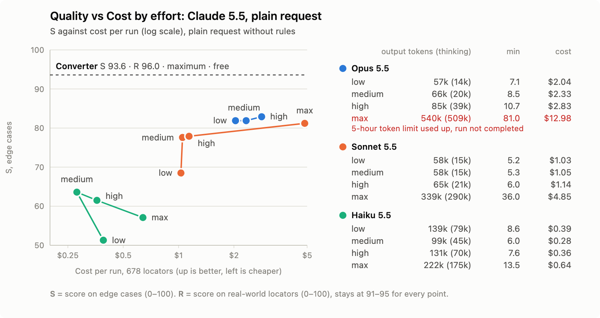
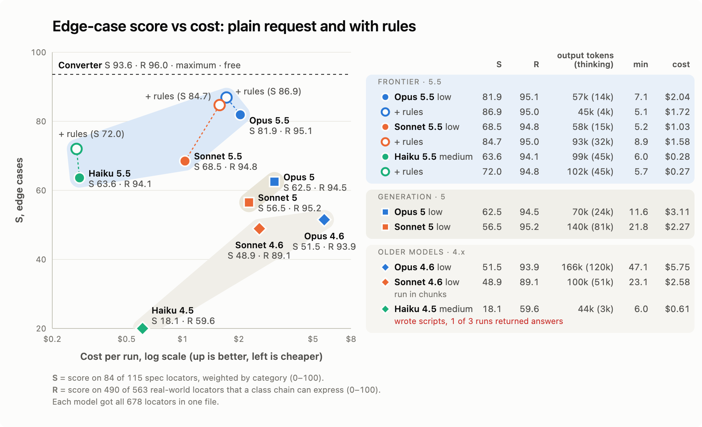

<!--
Images: dev.to does not take relative paths. Upload the PNGs from docs/articles/img/
in the editor (or use their raw GitHub URLs) and replace the paths below.
All numbers come from audit/coverage-report.md (Phase 4 and "Improved prompt (tested)"),
docs/results.md and audit/llm/scores/*.json.
-->

## TL;DR

- **No model beat the converter.** The best Claude run reached 96.7 % of the converter's usable chains on 676 locators and was ahead of it on none.
- **Without rules, every model run made wrong chains** (4 to 59 per run, the converter 0). A prompt with the rules brought Opus 5.5 and Sonnet 5.5 to **zero**.
- **Use the latest model at `low` or `medium` effort, with the rules.** `max` cost up to 4.6× more than `medium` for a few points; older generations were slower and made more mistakes.

---

**Contents**

1. [The test](#the-test)
2. [A plain request](#a-plain-request)
3. [Does a higher effort help?](#does-a-higher-effort-help)
4. [Older models](#older-models)
5. [What the models get wrong](#what-the-models-get-wrong)
6. [A prompt with rules](#a-prompt-with-rules)
7. [What I would use](#what-i-would-use)
8. [Limits](#limits)

---

In [part 1](https://dev.to/mikhail_yesipchuk/xpath-to-ios-class-chain-a-converter-you-can-trust-and-when-it-is-actually-faster-c6o) I built [xpath-to-class-chain](https://github.com/domovou69/xpath-to-class-chain), a converter from Appium XPath locators to iOS class chain, and checked it on 678 locators. The obvious question: why write a converter at all, if you can paste the locators into an LLM?

So I asked Claude to do the same job and scored the answers with the same checks.

## The test

- **The same 678 locators:** 563 real ones from production test suites and 115 hand-made edge cases. 676 are compared (one is not an XPath, one duplicates another at runtime).
- **One request per run:** the whole list in one file, shuffled, with neutral ids, so the model cannot tell real locators from edge cases. The model writes a chain or a skip with a reason for each id.
- **A clean environment:** Claude Code CLI in an empty folder, only `Read` and `Write` tools, no settings, no web, no examples beyond one chain in the prompt.
- **The same judge as the converter:** a WDA emulator built from WebDriverAgent's own code runs each chain and its XPath on hundreds of generated screens and compares what they find.

**Scoring**, as in part 1: an exact chain earns 1 point, a documented approximation 0.5, a skip or a wrong chain 0. **R** is the score on real locators, **S** on edge cases, both out of 100. The converter scores **R 96.0 / S 93.6**, which is the maximum for this scoring (some locators only have an approximation). I also count the converter's **579 usable chains as 100 %** and measure each model against that number.

A **wrong chain** below is one that WDA rejects or that finds other elements. It is worse than a skip: it looks like a valid locator, and the Appium driver reports an invalid chain as "no such element", so it shows up as a flaky test.



The plain request (full text in [`audit/llm/prompt.md`](https://github.com/domovou69/xpath-to-class-chain/blob/main/audit/llm/prompt.md)):

> `input.json` in the current folder has 678 XPath locators from iOS UI tests (Appium, XCUITest driver). Convert each one to an iOS class chain locator (`-ios class chain`) that finds the same elements. If a locator cannot be expressed as a class chain that finds the same elements, skip it and give the reason.

Then the output format: one JSON entry per id, either a chain with the `-ios class chain:` prefix or `skip` with a reason.

One run per model and effort level. Cost is the API-equivalent figure the CLI reports (I ran it on a subscription). Time is wall time, with three runs sharing one account in parallel. Scripts and raw outputs: [`audit/llm/`](https://github.com/domovou69/xpath-to-class-chain/tree/main/audit/llm).



## A plain request

The best effort level of each Claude 5.5 model, plain request:

| Model                   | R        | S        | Usable chains vs converter | Wrong chains | Time    | Cost      |
| ----------------------- | -------- | -------- | -------------------------- | ------------ | ------- | --------- |
| **Converter**           | **96.0** | **93.6** | **100 %**                  | **0**        | seconds | free      |
| Opus 5.5, `low`         | 95.1     | 81.9     | 96.7 %                     | 4            | 7.1 min | $2.04     |
| Sonnet 5.5, `low`       | 94.8     | 68.5     | 95.9 %                     | 7            | 5.2 min | $1.03     |
| Haiku 5.5, `medium`     | 94.1     | 63.6     | 93.8 %                     | 4            | 6.0 min | $0.28     |

- **On real locators the models are close.** R 94–95 against 96.0: most real locators are simple (`name`, `label`, type, `contains`), and every model converts them.
- **The gap is in edge cases.** S 64–82 against 93.6: positions, string functions, nested predicates, escaping.
- **Every run made wrong chains.** Four of 560 sounds like little, until it is the locator of your checkout button.

## Does a higher effort help?

Claude Code has effort levels from `low` to `max`; a higher one lets the model think longer. I ran each 5.5 model at `low`, `medium`, `high` and `max` (Opus `max` did not finish within the usage limit).

- **Opus:** `low` and `medium` gave identical answers; `high` added 1 point of S for 39 % more cost.
- **Sonnet:** the one real step is `low` → `medium` (S 68.5 → 77.6, same cost). `max` added 3.6 more for 4.6× the cost and 36 minutes.
- **Haiku:** best at `medium`. At `low` it used zero-based indexes (`[0]`) and made 39 wrong chains; at `max` it skipped a quarter of the list.

At `max`, 79–89 % of the output tokens were thinking that did not improve the answer. **`medium` is enough; for Opus, `low` is.**



| Model and effort | R    | S    | Wrong chains | Time, min | Cost  |
| ---------------- | ---- | ---- | ------------ | --------- | ----- |
| Haiku `low`      | 91.3 | 51.3 | 39           | 8.6       | $0.39 |
| Haiku `medium`   | 94.1 | 63.6 | 4            | 6.0       | $0.28 |
| Haiku `high`     | 94.5 | 61.5 | 5            | 7.6       | $0.36 |
| Haiku `max`      | 91.6 | 57.1 | 4            | 13.5      | $0.64 |
| Sonnet `low`     | 94.8 | 68.5 | 7            | 5.2       | $1.03 |
| Sonnet `medium`  | 94.1 | 77.6 | 7            | 5.3       | $1.05 |
| Sonnet `high`    | 94.2 | 77.9 | 7            | 6.0       | $1.14 |
| Sonnet `max`     | 95.1 | 81.2 | 6            | 36.0      | $4.85 |
| Opus `low`       | 95.1 | 81.9 | 4            | 7.1       | $2.04 |
| Opus `medium`    | 95.1 | 81.9 | 4            | 8.5       | $2.33 |
| Opus `high`      | 95.1 | 82.9 | 4            | 10.7      | $2.83 |

`xhigh` was not run. Opus `max` hit the 5-hour usage limit twice (81 minutes and about $13 in total) without a usable result.



## Older models

The same plain request to the previous generations, one run each:

| Model                 | R    | S    | Usable chains vs converter | Wrong chains | Time, min | Cost  |
| --------------------- | ---- | ---- | -------------------------- | ------------ | --------- | ----- |
| Opus 5.5, `low`       | 95.1 | 81.9 | 96.7 %                     | 4            | 7.1       | $2.04 |
| Opus 5, `low`         | 94.5 | 62.5 | 94.5 %                     | 6            | 11.6      | $3.11 |
| Opus 4.6, `low`       | 93.9 | 51.5 | 91.7 %                     | 11           | 47.1      | $5.75 |
| Sonnet 5.5, `low`     | 94.8 | 68.5 | 95.9 %                     | 7            | 5.2       | $1.03 |
| Sonnet 5, `low`       | 95.2 | 56.5 | 94.5 %                     | 12           | 21.8      | $2.27 |
| Sonnet 4.6, `low` ¹   | 89.1 | 48.9 | 86.5 %                     | 39           | 23.1      | $2.58 |
| Haiku 5.5, `medium`   | 94.1 | 63.6 | 93.8 %                     | 4            | 6.0       | $0.28 |
| Haiku 4.5, `medium` ² | 59.6 | 18.1 | 53.7 %                     | 59           | 6.0       | $0.61 |

¹ In seven runs of 100 locators: the full list wrote nothing in 20 minutes.
² In all three runs it wrote a Python converter instead of converting; this is the only run that ran its script and returned every answer.

Each new generation scored higher on edge cases, made fewer wrong chains, and was faster and cheaper. Opus 4.6 took 47 minutes and $5.75 to do worse than Haiku 5.5 did in 6 minutes for $0.28.

## What the models get wrong

The wrong chains are not random. Five mistakes make most of them:

| Mistake                                                                                       | Why it is wrong                                                                     | Who                                |
| --------------------------------------------------------------------------------------------- | ----------------------------------------------------------------------------------- | ---------------------------------- |
| A line break inside a literal written as a raw line break                                     | WDA cannot parse the chain                                                          | every Sonnet and Opus 5.5 run      |
| `(//Button)[last()]` → `**/XCUIElementTypeButton[-1]`                                         | WDA counts chain matches breadth-first, XPath top to bottom: another element        | 3–5 per run, more in stronger models |
| `[@label!="a"]` → ``[`label != "a"`]``                                                        | an element without a label passes in NSPredicate and fails in XPath                 | Haiku, Sonnet `low`–`high`         |
| `[.//*[@name="x"]]` → ``[$name == "x"$]``                                                     | `$…$` also matches the element itself, not only its descendants                     | Sonnet `medium`–`max`, every Opus run |
| `[1]` → `[0]`                                                                                  | class chain indexes start at 1                                                      | Haiku `low`                        |

The models also skip things they could convert: Opus at every level refused `matches()`, `ends-with()` and `lower-case()` as "XPath 2.0 functions". WDA registers them as XPath extensions, so they are valid locators on the driver.

The other direction exists too. At the time of the first runs a model found an exact chain for 30 locators where the converter skipped or approximated (unions as one `OR` predicate, `not()`, quotes and backticks inside literals, string functions). I added those forms to the converter after checking them with the emulator and, where they depend on how XCTest evaluates a predicate, on a simulator and an iPhone. So the LLM runs made the converter better, and after that no model was ahead of it on any locator.

## A prompt with rules

Most of the mistakes above are about knowing WDA, not about intelligence. So I wrote them down as general rules (structure, escaping, attributes, positions, what to skip) and ran the best effort level of each 5.5 model again with them. The rules: [`audit/llm/prompt-v4.md`](https://github.com/domovou69/xpath-to-class-chain/blob/main/audit/llm/prompt-v4.md), about 90 lines; there are no answers for particular locators in it.

| Model                          | R                | S                 | vs converter          | Wrong         | Min              | Cost               |
| ------------------------------ | ---------------- | ----------------- | --------------------- | ------------- | ---------------- | ------------------ |
| **Converter**                  | 96.0             | 93.6              | 100 %                 | **0**         | —                | free               |
| Opus 5.5, `low` + rules     | 95.1 95.0 (−0.1) | 81.9 86.9 (+5.0)  | 96.7 % 96.7 % (±0)   | 4 **0** (−4) | 7.1 5.1 (−2.0)   | $2.04 $1.72 (−0.32) |
| Sonnet 5.5, `low` + rules   | 94.8 95.0 (+0.2) | 68.5 84.7 (+16.2) | 95.9 % 96.4 % (+0.5) | 7 **0** (−7) | 5.2 8.9 (+3.7)   | $1.03 $1.58 (+0.55) |
| Haiku 5.5, `medium` + rules | 94.1 94.8 (+0.7) | 63.6 72.0 (+8.4)  | 93.8 % 95.7 % (+1.9) | 4 5 (+1)     | 6.0 5.7 (−0.3)   | $0.28 $0.27 (−0.01) |

Upper value: the plain request; lower: the same model with the rules, and the change in brackets. "vs converter" is usable chains against the converter's 579, "Wrong" the wrong chains.

- **R barely moved.** On real locators the models were already as good as they get.
- **S went up** by 5 (Opus), 16 (Sonnet) and 8 (Haiku), and the three models came closer to each other.
- **Opus and Sonnet made no wrong chains.** Haiku still made two kinds of mistake (one of them four times), so it needs a check.
- **Still no model is ahead of the converter** on any locator. With one run per model, differences of about 3 points in S are noise.



It took three versions, each changing one rule. The first version had no wrong chains but skipped 76 convertible real locators because of one over-cautious rule about `@type`; narrowing that rule fixed it. The third fixed `contains(@enabled,"false")`, which has to become `enabled == false` (`CONTAINS` on a boolean raises an error on the device). The rules came from device checks on a simulator and an iPhone, not from guesses.



## What I would use

1. **The converter first.** It is free, offline, takes seconds, gives the same answer every time and made no wrong chain. Nothing a model did was better.
2. **A model only for what the converter skips**, and only the latest generation: Opus 5.5 or Sonnet 5.5 at `low` or `medium`, with [the rules](https://github.com/domovou69/xpath-to-class-chain/blob/main/audit/llm/prompt-v4.md) in the prompt. Most skips have no exact chain at all, so expect the model to explain why rather than to convert.
3. **Check every chain a model writes** on its screen (or with the [harness](https://github.com/domovou69/xpath-to-class-chain/tree/main/audit/harness)) before it replaces the XPath.
4. **Do not pay for `max`.** It costs several times more, takes up to six times longer and did not get better answers.

If you use Claude Code, the repository has a [skill](https://github.com/domovou69/xpath-to-class-chain/tree/main/.claude/skills/xpath-to-class-chain) that does exactly this: it runs the converter, then explains each skipped locator and suggests a chain only where the rules give one, marked as unverified.

## Limits

- One run per model and effort level. Run-to-run variation was measured only in passing: about 3 points of S.
- Only Claude models. Other LLMs were not tested.
- The judge is the WDA emulator. The converter's chains were checked on a simulator and an iPhone; the forms only the models wrote (`MATCHES`, `[c]`, `$…$` with `ancestor::`) mostly were not.
- The edge cases are deliberately unusual. On a typical test suite the gap between a model and the converter is the R column: about 1 point.
- The whole list went in one request. Smaller batches may behave differently (Sonnet 4.6 only worked that way).

## Acknowledgements

Thanks to Anthropic: [Claude Code](https://claude.com/claude-code) helped me build the test setup and analyze the results, and the Claude models are also the subject of this test. All numbers come from real runs.

---

_[Mikhail Yesipchuk](https://www.linkedin.com/in/mikhail-yesipchuk/), SDET/Senior QA Automation Engineer. Which model do you use for test code, and where does it go wrong? Tell me on [LinkedIn](https://www.linkedin.com/in/mikhail-yesipchuk/) or open an issue on [GitHub](https://github.com/domovou69/xpath-to-class-chain/issues)._
